# ⚡ DURJOY | CSE STUDENT • FUTURE ML ENGINEER

<!-- ═══════════════════════ HERO ═══════════════════════ -->

<p align="center">
  
</p>

<p align="center">
  <a href="https://git.io/typing-svg">
    
  </a>
</p>

<p align="center">
  
  
  
</p>

<p align="center">
  
  &nbsp;
  
</p>

<p align="center">
  <a href="#-about-me"></a>
  <a href="#-tech-arsenal"></a>
  <a href="#-featured-project"></a>
  <a href="#-github-analytics"></a>
  <a href="#-roadmap"></a>
  <a href="#-lets-connect"></a>
</p>

<p align="center">
  <a href="https://github.com/NRD-404run?tab=repositories">
    
  </a>
</p>

---

## 👨‍💻 About Me

<p align="center">
  
</p>

<table>
<tr>
<td width="55%" valign="top">

```python
class Durjoy:
    name = "MD Naimur Rahman Durjoy"
    role = "CSE Student"
    university = "City University"

    languages = [
        "C", "C++", "Java", "Python"
    ]

    database = ["MySQL"]

    interests = [
        "Problem Solving",
        "Software Development",
        "Machine Learning"
    ]

    currently_learning = [
        "Python", "DSA", "Databases"
    ]

    goal = "Machine Learning Engineer"

    def motto(self):
        return "Consistency over perfection."


print(Durjoy().motto())
```

</td>
<td width="45%" valign="top">

### ◈ The Developer

- 🎓 CSE student at **City University**
- 💻 Interested in **coding and software development**
- 🩸 Building **Blood Link**, a Java-based donor management project
- 🌱 Strengthening **Python, DSA and problem-solving**
- 🤖 Working toward **Machine Learning**
- 🤝 Interested in collaborative programming projects
- ⚡ Turning bugs into lessons, one commit at a time

</td>
</tr>
</table>

<p align="center">
  <b><code>THINK → CODE → DEBUG → LEARN → REPEAT</code></b>
</p>

---

## 🛠️ Tech Arsenal

<p align="center">
  <b>⟡ PROGRAMMING LANGUAGES ⟡</b>
  <br/><br/>
  
</p>

<p align="center">
  <b>⟡ TOOLS & TECHNOLOGIES ⟡</b>
  <br/><br/>
  
</p>

<p align="center">
  <b>⟡ CURRENT FOCUS ⟡</b>
  <br/><br/>
  
  
  
</p>

---

## 🚀 Featured Project

<p align="center">
  
</p>

<table>
<tr>
<td>

<h3 align="center">🩸 Blood Link — Blood Donor Management System</h3>

<p align="center">
  A Java desktop application concept designed to help connect blood recipients with potential donors and manage donation requests.
</p>

<p align="center">
  
  
  
  
</p>

#### ◈ Planned Features

| Feature | Purpose |
|:--|:--|
| 🔐 Role-based login | Separate access for users and administrators |
| 🩸 Donor registration | Maintain donor information |
| 🔍 Blood-group search | Find donors by blood group |
| 📍 Location-based discovery | Help identify relevant nearby donors |
| 📩 Request management | Track blood donation requests |
| 🛡️ Admin controls | Support account and system management |

<p align="center">
  <sub>Features listed above represent the project plan and may not all be implemented yet.</sub>
</p>

</td>
</tr>
</table>

<p align="center">
  <b>MORE CODING • MORE PROJECTS • MORE PROGRESS</b>
</p>

---

## 📊 GitHub Analytics

<p align="center">
  
  
</p>

<p align="center">
  
</p>

<p align="center">
  <sub>Stats are generated by external services and may occasionally be unavailable or delayed.</sub>
</p>

---

## 🐍 Cyberpunk Contribution Snake

<p align="center">
  
</p>

<p align="center">
  
</p>

<p align="center">
  <b>🟢 NEON GREEN &nbsp; × &nbsp; 🟣 CYBER PURPLE</b>
  <br/>
  <sub>Every commit moves the mission forward.</sub>
  <br/><br/>
  <b>CODE&nbsp; • &nbsp;CREATE&nbsp; • &nbsp;CONQUER</b>
</p>

---

## 🏆 Achievements & Milestones

<p align="center">
  
</p>

- 🎯 Improve problem-solving skills through consistent practice.
- 💻 Build and publish useful programming projects.
- 🌱 Develop a strong foundation in Python and Machine Learning.
- 🤝 Explore open-source contributions and collaboration.

<p align="center">
  <a href="https://github.com/NRD-404run?tab=achievements">
    
  </a>
</p>

<p align="center">
  <sub>Official GitHub achievements appear when earned and visible on your profile.</sub>
</p>

---

## 🎯 Machine Learning Roadmap

| Stage | Goal | Status |
|:--:|:--|:--:|
| 01 | Programming fundamentals | ✅ Completed |
| 02 | Java, OOP and database basics | ✅ Covered |
| 03 | Strengthen DSA and problem-solving | 🔄 In progress |
| 04 | Build Python projects | 🔜 Next |
| 05 | Learn NumPy, Pandas and data analysis | 🎯 Planned |
| 06 | Study statistics and ML fundamentals | 🎯 Planned |
| 07 | Build practical Machine Learning projects | 🎯 Planned |
| 08 | Explore deep learning and real-world datasets | 🚀 Future |
| 09 | Contribute to open-source projects | 🌍 Future |

<p align="center">
  <b>THE MISSION: FROM CSE STUDENT TO MACHINE LEARNING ENGINEER</b>
</p>

---

## 🌱 Beyond the Code

<p align="center">
  
  
  
  
  
  
</p>

---

## 🌐 Let's Connect

<p align="center">
  <a href="https://github.com/NRD-404run">
    
  </a>
  <a href="https://twitter.com/mddurjoy16250">
    
  </a>
  <a href="https://www.facebook.com/md.naimur.rahman.durjoy.360743">
    
  </a>
  <a href="mailto:mddurjoy54531113@gmail.com">
    
  </a>
</p>

<p align="center">
  <i>"First, solve the problem. Then, write the code."</i>
  <br/><br/>
  <b>⭐ Thanks for visiting my profile!</b>
  <br/>
  <sub>KEEP LEARNING • KEEP BUILDING • KEEP GROWING</sub>
</p>


